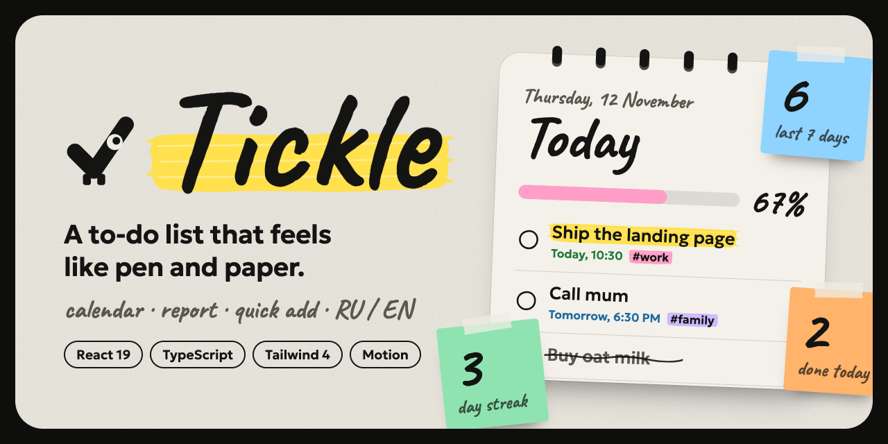

<div align="center">



# Tickle

**A to-do list that feels like pen and paper.**

Plan your days in a notebook-style app: a calendar, a productivity report, quick add that understands plain text, and a mascot with opinions. Everything lives in your browser. No account, no server.

[English](README.md) · [Русский](README.ru.md)


</div>

---

## Contents

- [Why Tickle](#why-tickle)
- [Features](#features)
- [Quick add](#quick-add)
- [Shortcuts and gestures](#shortcuts-and-gestures)
- [Getting started](#getting-started)
- [Tech stack](#tech-stack)
- [Design system](#design-system)
- [How it works](#how-it-works)
- [Data and privacy](#data-and-privacy)
- [Testing](#testing)
- [Browser support](#browser-support)
- [What is not included](#what-is-not-included)
- [Deploying](#deploying)
- [Built with AI](#built-with-ai)
- [License](#license)

## Why Tickle

Most task apps are either bare checklists or dense dashboards. Tickle tries a third way: the speed and structure of a modern planner (sidebar views, inline add, undo, search) wrapped in a calm, tactile interface that looks drawn rather than rendered.

- **Fast to use.** Type `!Call mum tomorrow at 18:30 #family` and the title, priority, date, time and project are filled in for you.
- **Forgiving.** Deleting, completing or clearing tasks can be undone from a toast, so there are no "are you sure?" dialogs.
- **Yours.** All data stays in `localStorage`. Nothing leaves the browser.
- **Bilingual.** Russian and English, with Russian first. The choice is remembered.

## Features

**Tasks**
- Add tasks with the button or Enter; blank titles are rejected and whitespace is trimmed
- Complete and restore tasks, edit them in place (click the title), delete them
- Undo for completing, deleting and clearing completed tasks
- Priority tasks are highlighted with a brush-stroke marker and listed first

**Planning**
- Due dates and times of day, set from a notebook-style picker or typed in the title
- Views: **All**, **Today** (with overdue tasks under their own heading), **Upcoming** (grouped by day), **Active**, **Completed**
- Projects created simply by writing `#name`; each project gets its own highlighter colour
- Search across tasks

**Calendar**
- A month page of a spiral notebook: tasks are written right on their days with colour-coded marker strokes
- Move between days with the arrow keys, hover a day for a quick **+** to add a task to it
- Click a day to circle it and see (and add) its tasks

**Report**
- Sticky notes with tasks done today and over the last 7 days, the day streak and the completion rate
- Overdue and due-today stamps
- A 7-day brush-stroke bar chart on a ruled notebook page, with a screen-reader table behind it

**Feel**
- **Tick**, the mascot: a check mark with one eye that follows your pointer and hops when you finish a task
- Task titles are set in our handwriting, and a new task is **written out with a pen** that travels along the line
- Hand-drawn checkboxes, completed tasks crossed out by an uneven pen stroke that is drawn across the text
- Every icon has its own hover animation (the bin lifts its lid, the pencil writes, the calendar flips)
- Swipe a task **left to delete** or **right to complete**: a coloured patch shows what will happen, the first task demonstrates the gesture once on touch screens, and a handwritten hint sits under the list
- Responsive layout (sidebar on desktop, top bar on phones); animation respects `prefers-reduced-motion`

## Quick add

Recognised anywhere in the text and removed from the title. The recognised parts appear as chips under the input.

| You type | Meaning |
| --- | --- |
| `!` at the start | Priority task |
| `#family` | Project `family` |
| `today`, `tomorrow`, `сегодня`, `завтра` | Due date |
| `2026-12-24` | Due date (ISO) |
| `18:30`, `at 6pm`, `6:30pm`, `в 18:30` | Time of day (a time alone means today) |

Example: `!Call mum tomorrow at 6:30pm #family` creates the task **Call mum**, flagged as priority, due tomorrow at 18:30, in the project `family`.

## Shortcuts and gestures

| Action | How |
| --- | --- |
| Open the add form from anywhere | `/` |
| Close the form, clear the search, close the picker | `Esc` |
| Submit a task and stay in the form for the next one | `Enter` |
| Edit a task | Click its title, or the pencil |
| Move between days in the calendar | Arrow keys |
| Delete a task | Swipe left, or the bin |
| Complete a task | Swipe right, or the checkbox |

## Getting started

Requires **Node.js 20 or newer**.

```bash
git clone <your-repo-url>
cd <repo-folder>
npm install
npm run dev
```

Open the URL printed in the terminal (usually http://localhost:5173).

| Command | What it does |
| --- | --- |
| `npm run dev` | Start the dev server |
| `npm run build` | Type-check and build for production into `dist/` |
| `npm run preview` | Serve the production build locally |
| `npm run lint` | Lint with Oxlint |
| `npm run typecheck` | Run the TypeScript compiler |
| `npm run test` | Run the test suite once |

## Tech stack

| | Used for |
| --- | --- |
| [React](https://react.dev) 19 + TypeScript | UI and typed state |
| [Vite](https://vite.dev) | Dev server and build |
| [Tailwind CSS](https://tailwindcss.com) v4 | Styling with design tokens |
| [Motion](https://motion.dev) | Springs, layout animation, gestures, drawn paths |
| [Fontsource](https://fontsource.org) | Self-hosted fonts, no external requests |
| [Vitest](https://vitest.dev) + Testing Library | Unit and user-flow tests |
| [Oxlint](https://oxc.rs/docs/guide/usage/linter) | Linting |

No router, no state library, no backend: state is a React hook, persistence is a small module around `localStorage`.

## Design system

**Pen and paper.** A cream page on a black frame, a little paper grain, ink-black type and a set of highlighters.

**Two type roles, both with Cyrillic**

| Role | Font | Where |
| --- | --- | --- |
| Headings and notes | Caveat (handwritten) | Titles, the logo, dates above titles, calendar numbers, report figures |
| Interface and task text | Geologica | Menus, buttons, chips, dates and times, the text of your tasks |

**Colour has meaning**

| Colour | Means |
| --- | --- |
| Yellow | Important |
| Green | Today |
| Blue | Tomorrow and upcoming |
| Red | Overdue |
| Pink, orange, lilac, blue | Projects (chosen from the project name) |

**Motion has a purpose.** Springs for list changes, a left-to-right "painted on" highlight for the selected menu item, a pen stroke for completing a task, a progress strip that changes colour through the day. Reduced-motion users get instant transitions.

## How it works

```
src/
  App.tsx            layout, navigation state, global shortcut
  useTodos.ts        state, persistence and undo in one hook
  todos.ts           task model, reducer and view selectors
  dates.ts           date and time helpers, month grid, quick-add parser
  report.ts          productivity report calculations
  storage.ts         localStorage read/write with validation
  i18n.ts            Russian and English strings
  palette.ts         highlighter colours and brush-stroke backgrounds
  motion.ts          shared spring and easing tokens
  components/        Sidebar, ListHeader, TaskList, TodoItem, AddTask,
                     CalendarView, DatePicker, ReportView, EmptyState,
                     Toast, LangSwitch, PenText, Burst, Tick, icons
```

- **Pure core.** The reducer, selectors, parser and report are plain functions with no React, which is why they are easy to test.
- **One storage module.** Every `localStorage` access goes through `src/storage.ts`.
- **Measured pen strokes.** The cross-out is drawn per rendered line of text, so wrapped titles are handled.

## Data and privacy

Tickle has no backend and sends nothing anywhere. Everything is stored in your browser's `localStorage`.

| Key | Content |
| --- | --- |
| `todo-list:v1` | JSON array of tasks: `{ id, text, completed, priority?, due?, time?, project?, completedAt?, createdAt }` |
| `todo-list:lang` | `"ru"` or `"en"` |
| `todo-list:swipe-hint` | `"1"` after the one-time swipe demonstration |

- `due` is a local `YYYY-MM-DD` date and `time` is a 24-hour `HH:MM`.
- Saved data is read and validated **before the first render**, so it is never overwritten by an empty list.
- Corrupted JSON, non-array data and malformed items are ignored instead of crashing the app.
- If the browser blocks storage, the app keeps working for the session and shows a notice that tasks will not be saved.

Clearing site data in your browser removes your tasks. There is no sync between devices.

## Testing

```bash
npm run test
```

- **Logic:** reducer, view selectors, counts, project colours
- **Quick-add parser:** priority, projects, dates and times in English and Russian, impossible values, date words inside other words
- **Report:** per-day counts, streak rules, rates
- **Storage:** valid, missing, corrupted and malformed data; unavailable storage
- **User flows (Testing Library):** add, complete, filter, delete, persist across reloads, undo, edit, search, calendar, report, date and time picker, keyboard shortcut, language switch

`npm run lint`, `npm run typecheck` and `npm run build` are expected to pass cleanly as well.

## Browser support

Current evergreen browsers (Chrome and Edge 110+, Safari 16.4+, Firefox 115+). The app relies on modern `Intl`, regular-expression lookbehind and `Array.prototype.toSorted`.

## What is not included

Tickle is a client-only app by design. These are deliberately out of scope:

- Sync between devices, accounts and sharing
- Reminders and push notifications
- Recurring tasks and sub-tasks
- Dark theme (the paper look is the point)
- Import and export of data
- Drag-and-drop reordering

## Deploying

Tickle is a static site, so any static host works. On [Vercel](https://vercel.com), import the repository: the Vite preset is detected automatically (build command `npm run build`, output directory `dist`). Netlify, GitHub Pages and Cloudflare Pages work the same way.

## Built with AI

This project was built with [Claude Code](https://claude.com/claude-code) (Anthropic). Claude Code wrote the code, the tests, this README and the repository preview image from a written specification and a long series of design conversations. Design decisions were made by a human, and the result was checked in a browser and with the automated tests above.

## License

[MIT](LICENSE)
