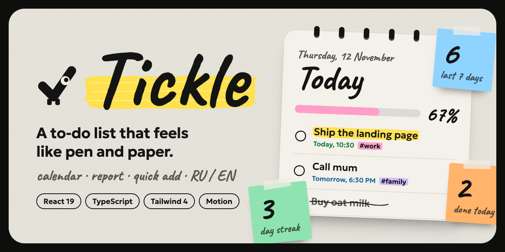

<div align="center">



# Tickle

**Список дел, который ощущается как ручка и бумага.**

Планируйте дни в приложении в стиле блокнота: календарь, отчёт о продуктивности, быстрый ввод, который понимает обычный текст, и талисман с характером. Всё хранится в вашем браузере. Без аккаунта и без сервера.

**[Демо онлайн: tikleproject.vercel.app](https://tikleproject.vercel.app)**

[English](README.md) · [Русский](README.ru.md)


</div>

---

## Содержание

- [Зачем Tickle](#зачем-tickle)
- [Возможности](#возможности)
- [Быстрый ввод](#быстрый-ввод)
- [Клавиши и жесты](#клавиши-и-жесты)
- [Запуск](#запуск)
- [Технологии](#технологии)
- [Дизайн-система](#дизайн-система)
- [Как это устроено](#как-это-устроено)
- [Данные и приватность](#данные-и-приватность)
- [Тесты](#тесты)
- [Поддержка браузеров](#поддержка-браузеров)
- [Чего нет](#чего-нет)
- [Публикация](#публикация)
- [Сделано с помощью ИИ](#сделано-с-помощью-ии)
- [Лицензия](#лицензия)

## Зачем Tickle

Большинство приложений для задач либо голые чек-листы, либо плотные панели. Tickle идёт третьим путём: скорость и структура современного планировщика (разделы в боковой панели, добавление прямо в списке, отмена, поиск) в спокойном тактильном интерфейсе, который выглядит нарисованным, а не отрисованным.

- **Быстро.** Напишите `!Позвонить маме завтра в 18:30 #семья`, и название, приоритет, дата, время и проект заполнятся сами.
- **Без страха ошибиться.** Выполнение, удаление и очистку можно отменить из уведомления, поэтому нет диалогов «вы уверены?».
- **Ваше.** Все данные остаются в `localStorage`. Ничто не покидает браузер.
- **Два языка.** Русский и английский, русский первым. Выбор запоминается.

## Возможности

**Задачи**
- Добавление кнопкой или Enter; пустые названия не принимаются, пробелы по краям обрезаются
- Выполнение и возврат, правка на месте (клик по названию), удаление
- Отмена после выполнения, удаления и очистки выполненных
- Важные задачи подсвечены мазком маркера и стоят первыми

**Планирование**
- Сроки и время суток: из календарика в стиле блокнота или прямо в названии
- Разделы: **Все**, **Сегодня** (просроченные под отдельным заголовком), **Предстоящие** (по дням), **Активные**, **Выполненные**
- Проекты создаются тегом `#название`; у каждого проекта свой цвет маркера
- Поиск по задачам

**Календарь**
- Страница спирального блокнота на месяц: задачи записаны прямо на своих днях цветными мазками
- По дням можно ходить стрелками клавиатуры, при наведении на день появляется **+** для быстрого добавления
- Клик по дню обводит его от руки и показывает (и позволяет добавить) его задачи

**Отчёт**
- Цветные записки: сделано сегодня и за 7 дней, серия дней подряд, процент выполнения
- Штампы «Просрочено» и «Срок сегодня»
- Столбчатый график за 7 дней мазками кисти на странице в линейку, с таблицей для скринридеров

**Характер**
- **Тик**, талисман: галочка с одним глазом, который следит за курсором и подпрыгивает, когда вы выполняете задачу
- Названия задач набраны нашим рукописным шрифтом, а новая задача **пишется пером**, которое движется по строке
- Нарисованные от руки чекбоксы: при выполнении задачи перо рисует галочку, затем зачёркивает название неровным росчерком, строка за строкой
- У каждой иконки своя анимация при наведении (корзина поднимает крышку, карандаш пишет, календарь перелистывается)
- **Свайп влево удаляет, вправо выполняет**: цветная плашка показывает, что произойдёт, первая задача один раз демонстрирует жест на сенсорных экранах, под списком рукописная подсказка
- Адаптивная раскладка (боковая панель на компьютере, верхняя полоса на телефоне); анимации учитывают `prefers-reduced-motion`

## Быстрый ввод

Распознаётся в любом месте текста и убирается из названия. Распознанное показывается чипами под полем.

| Вы пишете | Значение |
| --- | --- |
| `!` в начале | Важная задача |
| `#семья` | Проект `семья` |
| `сегодня`, `завтра`, `today`, `tomorrow` | Срок |
| `2026-12-24` | Срок (ISO-дата) |
| `18:30`, `в 18:30`, `6pm`, `6:30pm` | Время суток (одно время означает сегодня) |

Пример: `!Позвонить маме завтра в 18:30 #семья` создаст задачу **Позвонить маме**, важную, со сроком завтра в 18:30, в проекте `семья`.

## Клавиши и жесты

| Действие | Как |
| --- | --- |
| Открыть форму добавления откуда угодно | `/` |
| Закрыть форму, очистить поиск, закрыть календарик | `Esc` |
| Добавить задачу и остаться в форме для следующей | `Enter` |
| Изменить задачу | Клик по названию или карандаш |
| Ходить по дням в календаре | Стрелки |
| Удалить задачу | Свайп влево или корзина |
| Выполнить задачу | Свайп вправо или чекбокс |

## Запуск

Нужен **Node.js 20 или новее**.

```bash
git clone <адрес-вашего-репозитория>
cd <папка-репозитория>
npm install
npm run dev
```

Откройте адрес, который выведет терминал (обычно http://localhost:5173).

| Команда | Что делает |
| --- | --- |
| `npm run dev` | Запускает сервер разработки |
| `npm run build` | Проверяет типы и собирает проект в `dist/` |
| `npm run preview` | Запускает собранную версию локально |
| `npm run lint` | Линтер Oxlint |
| `npm run typecheck` | Проверка типов TypeScript |
| `npm run test` | Один прогон тестов |

## Технологии

| | Для чего |
| --- | --- |
| [React](https://react.dev) 19 + TypeScript | Интерфейс и типизированное состояние |
| [Vite](https://vite.dev) | Сервер разработки и сборка |
| [Tailwind CSS](https://tailwindcss.com) v4 | Стили на дизайн-токенах |
| [Motion](https://motion.dev) | Пружины, анимация расположения, жесты, прорисовка линий |
| [Fontsource](https://fontsource.org) | Свои шрифты, без внешних запросов |
| [Vitest](https://vitest.dev) + Testing Library | Модульные тесты и сценарии пользователя |
| [Oxlint](https://oxc.rs/docs/guide/usage/linter) | Линтер |

Ни роутера, ни библиотеки состояния, ни сервера: состояние это React-хук, хранение это маленький модуль вокруг `localStorage`.

## Дизайн-система

**Ручка и бумага.** Кремовая страница на чёрной рамке, немного зерна бумаги, чёрные чернила и набор маркеров.

**Две роли шрифтов, оба с кириллицей**

| Роль | Шрифт | Где |
| --- | --- | --- |
| Заголовки и заметки | Caveat (рукописный) | Заголовки, логотип, дата над заголовком, числа в календаре, цифры отчёта |
| Интерфейс и текст задач | Geologica | Меню, кнопки, чипы, даты и время, текст ваших задач |

**Цвет несёт смысл**

| Цвет | Значение |
| --- | --- |
| Жёлтый | Важное |
| Зелёный | Сегодня |
| Голубой | Завтра и предстоящее |
| Красный | Просрочено |
| Розовый, оранжевый, сиреневый, голубой | Проекты (выбираются по названию проекта) |

**У движения есть смысл.** Пружины для изменений списка, «закрашивание» слева направо у выбранного пункта меню, росчерк ручки при выполнении задачи, полоса прогресса, меняющая цвет в течение дня. Для тех, кто отключил анимации, переходы мгновенные.

## Как это устроено

```
src/
  App.tsx            раскладка, состояние навигации, глобальная клавиша
  useTodos.ts        состояние, сохранение и отмена в одном хуке
  todos.ts           модель задачи, редьюсер и выборки по разделам
  dates.ts           даты и время, сетка месяца, разбор быстрого ввода
  report.ts          расчёты отчёта о продуктивности
  storage.ts         чтение и запись localStorage с проверкой
  i18n.ts            строки на русском и английском
  palette.ts         цвета маркеров и фоны-мазки кисти
  motion.ts          общие токены пружин и кривых
  components/        Sidebar, ListHeader, TaskList, TodoItem, AddTask,
                     CalendarView, DatePicker, ReportView, EmptyState,
                     Toast, LangSwitch, PenText, Burst, Tick, icons
```

- **Чистое ядро.** Редьюсер, выборки, разбор ввода и отчёт это обычные функции без React, поэтому их легко тестировать.
- **Один модуль хранения.** Любое обращение к `localStorage` идёт через `src/storage.ts`.
- **Измеренный росчерк.** Зачёркивание рисуется для каждой отрисованной строки текста, поэтому длинные названия с переносом тоже обработаны.

## Данные и приватность

У Tickle нет сервера, и он ничего никуда не отправляет. Всё хранится в `localStorage` вашего браузера.

| Ключ | Содержимое |
| --- | --- |
| `todo-list:v1` | JSON-массив задач: `{ id, text, completed, priority?, due?, time?, project?, completedAt?, createdAt }` |
| `todo-list:lang` | `"ru"` или `"en"` |
| `todo-list:swipe-hint` | `"1"` после разового показа жеста |

- `due` это локальная дата `ГГГГ-ММ-ДД`, `time` это время `ЧЧ:ММ` в 24-часовом формате.
- Сохранённые данные читаются и проверяются **до первого рендера**, поэтому их никогда не затирает пустой список.
- Испорченный JSON, не-массив и некорректные элементы игнорируются, а не роняют приложение.
- Если браузер блокирует хранилище, приложение продолжает работать в рамках сессии и сообщает, что задачи не сохранятся.

Очистка данных сайта в браузере удалит ваши задачи. Синхронизации между устройствами нет.

## Тесты

```bash
npm run test
```

- **Логика:** редьюсер, выборки по разделам, счётчики, цвета проектов
- **Разбор быстрого ввода:** приоритет, проекты, даты и время на русском и английском, невозможные значения, слова-даты внутри других слов
- **Отчёт:** подсчёт по дням, правила серии, проценты
- **Хранилище:** корректные, отсутствующие, испорченные и некорректные данные; недоступное хранилище
- **Сценарии пользователя (Testing Library):** добавление, выполнение, фильтры, удаление, сохранение между перезагрузками, отмена, правка, поиск, календарь, отчёт, выбор даты и времени, клавиша, смена языка

`npm run lint`, `npm run typecheck` и `npm run build` тоже должны проходить без замечаний.

## Поддержка браузеров

Современные браузеры (Chrome и Edge 110+, Safari 16.4+, Firefox 115+). Приложение использует современный `Intl`, lookbehind в регулярных выражениях и `Array.prototype.toSorted`.

## Чего нет

Tickle намеренно клиентское приложение. За рамками осознанно оставлено:

- Синхронизация между устройствами, аккаунты и общий доступ
- Напоминания и push-уведомления
- Повторяющиеся задачи и подзадачи
- Тёмная тема (бумажный вид это и есть идея)
- Импорт и экспорт данных
- Перетаскивание для смены порядка

## Публикация

Tickle это статический сайт, подойдёт любой хостинг статики. На [Vercel](https://vercel.com) импортируйте репозиторий: пресет Vite определится автоматически (команда сборки `npm run build`, папка вывода `dist`). Netlify, GitHub Pages и Cloudflare Pages работают так же.

## Сделано с помощью ИИ

Проект сделан с помощью [Claude Code](https://claude.com/claude-code) (Anthropic). Claude Code написал код, тесты, этот README и превью-картинку репозитория по письменному заданию и длинной серии обсуждений дизайна. Дизайнерские решения принимал человек, результат проверен в браузере и автоматическими тестами, перечисленными выше.

## Лицензия

[MIT](LICENSE)
